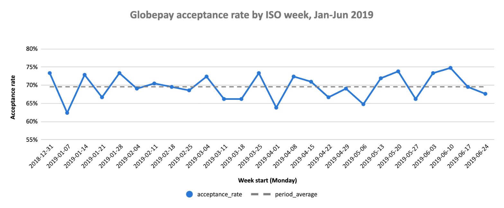
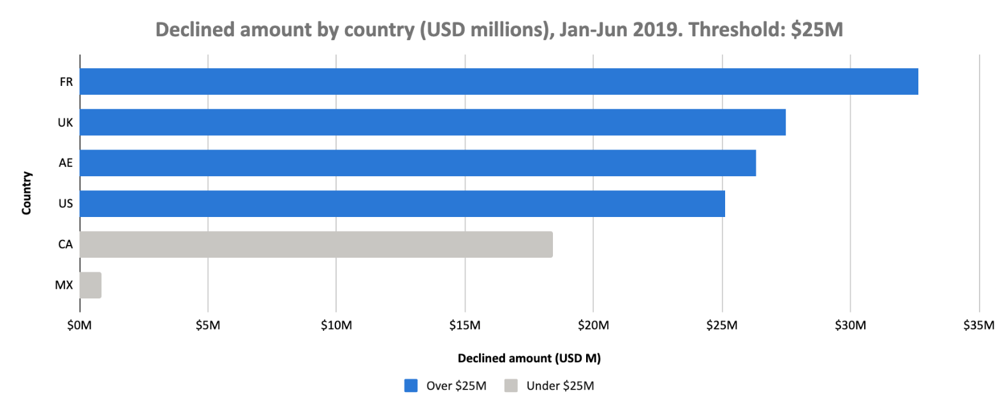

# Part 2 – guide for the Data Analyst

## The model: `analytics_finance.fct_globepay_transactions`

**One row per Globepay payment attempt** (5,430 rows, 1 Jan – 30 Jun 2019), with its outcome, its amount in local currency and in USD, and its chargeback status.
It combines the Globepay acceptance report with the chargeback report, so you don't need to join anything yourself.

| Column | Use it for |
|---|---|
| `transaction_id` | Unique ID of the payment attempt (primary key) |
| `transaction_at` / `transaction_date` | Time analysis: group by day, week or month with `DATE_TRUNC(transaction_date, ISOWEEK)` |
| `country_code`, `currency_code` | Breakdowns by country / currency |
| `is_accepted` | Acceptance rate: `(COUNTIF(is_accepted) / COUNT(*))` |
| `amount_usd` | Always use this to compare or sum amounts across countries |
| `amount_local` | Amount in the original currency (only comparable within the same currency) |
| `has_chargeback_data` | FALSE = the transaction has no row in the chargeback report |
| `is_chargeback` | TRUE/FALSE = charged back or not; **NULL = unknown** (no chargeback data) |

### Things to keep in mind

- `is_chargeback` NULL means "missing data", not "no chargeback". Filter on `has_chargeback_data` before computing chargeback rates.
- USD amounts depend on Globepay's FX rates (`amount_usd = amount_local / fx_rate_to_usd`), taken from the report at transaction time.
- The United Kingdom is coded `UK`, not `GB`.
- The United Arab Emirates (`AE`) is charged in USD, not in AED.
- One accepted transaction has a negative amount (-23.78 GBP). It is kept as reported by Globepay.
- Chargebacks only appear on accepted transactions (223 of 3,777).

## Q1. What is the acceptance rate over time?

Query: [`01_acceptance_rate_over_time.sql`](01_acceptance_rate_over_time.sql) (grain = `ISOWEEK`, weeks start on Monday; change `grain` to `DAY` or `MONTH` for a different granularity).

| Week start (Monday) | Payment attempts | Accepted | Acceptance rate |
|---|---|---|---|
| 2018-12-31 ¹ | 180 | 132 | 73.33% |
| 2019-01-07 | 210 | 131 | 62.38% |
| 2019-01-14 | 210 | 153 | 72.86% |
| 2019-01-21 | 210 | 140 | 66.67% |
| 2019-01-28 | 210 | 154 | 73.33% |
| 2019-02-04 | 210 | 145 | 69.05% |
| 2019-02-11 | 210 | 148 | 70.48% |
| 2019-02-18 | 210 | 146 | 69.52% |
| 2019-02-25 | 210 | 144 | 68.57% |
| 2019-03-04 | 210 | 152 | 72.38% |
| 2019-03-11 | 210 | 139 | 66.19% |
| 2019-03-18 | 210 | 139 | 66.19% |
| 2019-03-25 | 210 | 154 | 73.33% |
| 2019-04-01 | 210 | 134 | 63.81% |
| 2019-04-08 | 210 | 152 | 72.38% |
| 2019-04-15 | 210 | 149 | 70.95% |
| 2019-04-22 | 210 | 140 | 66.67% |
| 2019-04-29 | 210 | 145 | 69.05% |
| 2019-05-06 | 210 | 136 | 64.76% |
| 2019-05-13 | 210 | 151 | 71.90% |
| 2019-05-20 | 210 | 155 | 73.81% |
| 2019-05-27 | 210 | 139 | 66.19% |
| 2019-06-03 | 210 | 154 | 73.33% |
| 2019-06-10 | 210 | 157 | 74.76% |
| 2019-06-17 | 210 | 146 | 69.52% |
| 2019-06-24 | 210 | 142 | 67.62% |
| **Total** | **5,430** | **3,777** | **69.56%** |

¹ The first ISO week has 6 days of data (180 attempts): 1 Jan 2019 is a Tuesday.

The acceptance rate is stable at around **70%**, with no clear trend. Week by week it moves between 62.4% (week of 7 Jan) and 74.8% (week of 10 Jun). With about 210 attempts
per week, swings of a few points are expected and should not be read as a change in behaviour.



### By country

Query: [`01_acceptance_rate_by_country.sql`](01_acceptance_rate_by_country.sql) (grain = `MONTH`; weekly would leave about 35 attempts per country, too few to read).

| Country | Jan | Feb | Mar | Apr | May | Jun | **Jan–Jun** |
|---|---|---|---|---|---|---|---|
| UK | 69.0% | 69.3% | 67.7% | 72.0% | 74.2% | 76.7% | **71.5%** |
| MX | 74.2% | 67.9% | 69.7% | 64.7% | 74.2% | 76.0% | **71.2%** |
| FR | 67.7% | 75.7% | 74.2% | 67.3% | 67.1% | 68.7% | **70.1%** |
| CA | 74.8% | 74.3% | 67.7% | 66.7% | 66.5% | 68.0% | **69.6%** |
| AE | 65.2% | 69.3% | 69.7% | 64.7% | 67.7% | 70.7% | **67.8%** |
| US | 66.5% | 64.3% | 64.5% | 71.3% | 66.5% | 70.0% | **67.2%** |
| **All** | 69.6% | 70.1% | 68.9% | 67.8% | 69.4% | 71.7% | **69.6%** |

Each country has 905 attempts (about 150 a month). Over the period the rate goes from 67.2% (US) to 71.5% (UK), a spread of about 4 points. This is within what chance alone produces with these volumes: a chi-squared test across the six countries gives 6.5, below the 11.1 needed at 5% significance. Month by month, one standard deviation is about ±3.7 points, so single months between 64% and 77% are expected.

Two movements are worth watching, but are not significant yet: the UK goes from 68.7% in Jan–Mar to 74.3% in Apr–Jun, and Canada from 72.2% to 67.0%. Neither change is significant at 5%, so they should not be presented as a trend before more months of data confirm them.

## Q2. Which countries had more than $25M of declined transactions?

Query: [`02_countries_declined_over_25m.sql`](02_countries_declined_over_25m.sql).

| Country | Declined attempts | Declined amount (USD) |
|---|---|---|
| FR | 271 | 32.63M |
| UK | 258 | 27.49M |
| AE | 291 | 26.34M |
| US | 297 | 25.13M |

Four countries out of six are over $25M. The US is only $0.13M over the threshold: its amounts are in USD, so FX rates do not affect it, but a slightly different period would move it below. Canada ($18.4M) and Mexico ($0.9M) are below.

The UK result depends on FX. EUR and GBP fall about 25% against USD over the period (EUR 0.92 → 0.67, GBP 0.87 → 0.66 per USD), so later declines are worth more in USD. At 1 Jan rates the UK would total $24.0M, below the threshold; France would stay above at $26.8M.

The answer also depends on how `amount` is read. Amounts have the same distribution in every currency (median about 85–88k in USD and in MXN alike), which is why Mexico weighs only $0.9M once converted. The model reads them as local-currency amounts and converts them with Globepay's rates. If they were already in USD, the countries over $25M would be AE, CA and US instead. In minor units no country would get above $0.33M. See [Part 1, section 1.3](../../docs/ingestion_and_modeling.md#13-open-question-what-unit-and-currency-is-amount-in); this should be confirmed with Globepay.



### When each country went over $25M

Query: [`02_date_declined_crossed_25m.sql`](02_date_declined_crossed_25m.sql) (running total of declined `amount_usd` per country, in time order).

| Country | Declined amount (USD), Jan–Jun | Went over $25M on | Days before the end of the data |
|---|---|---|---|
| FR | 32.63M | 13 Jun 2019 | 17 |
| UK | 27.49M | 22 Jun 2019 | 8 |
| AE | 26.34M | 27 Jun 2019 | 3 |
| US | 25.13M | 30 Jun 2019 | 0 |
| CA | 18.42M | not reached | – |
| MX | 0.88M | not reached | – |

All four countries go over the threshold in the last 18 days of the data, and the US only with its last declined attempt (30 Jun, 09:36). The $25M is a cumulative total over six months, so the list depends on the period: at the end of May no country had reached it. If the analyst needs a recurring check, a threshold per month or per quarter is more useful than one total over the whole history.

## Q3. Which transactions are missing chargeback data?

Query: [`03_transactions_missing_chargeback.sql`](03_transactions_missing_chargeback.sql).

**Answer: none.** All 5,430 payment attempts have a row in the chargeback report. The query will list the transactions with missing data if they appear in future loads, and a `warn`-level `relationships` test from acceptances to chargebacks flags them on every `dbt build`.

Two things to keep in mind when you use the chargeback data:

- **For declined transactions, `is_chargeback = FALSE` means "not applicable".** A declined payment is never charged,
  so it cannot be charged back. Compute chargeback rates on accepted transactions only
  (223 chargebacks out of 3,777 accepted, 5.9%).
- **"Has chargeback data" is not the same as "final".** Chargebacks can arrive weeks after the payment, and the
  chargeback report has no date, so a recent transaction with `is_chargeback = FALSE` may still be charged back later.
  Treat chargeback rates for the most recent weeks as provisional.

## How to run the queries

```bash
export DBT_PROFILES_DIR=.
.venv/bin/dbt show --select 01_acceptance_rate_over_time --limit 100
```
Or compile them (`dbt compile --select analyses/questions`) and run the SQL in `target/compiled/` directly in BigQuery.
