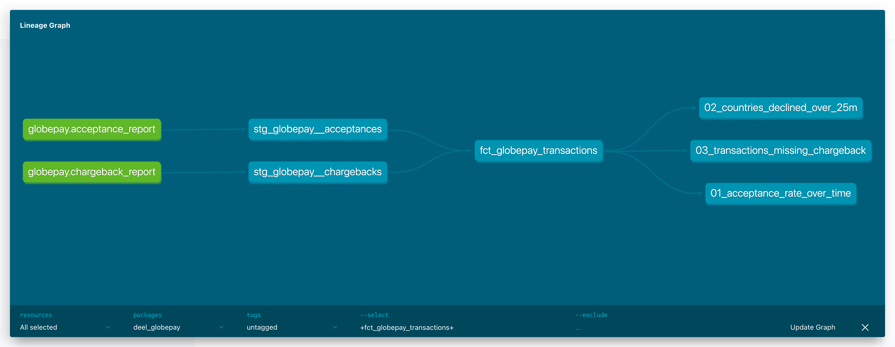
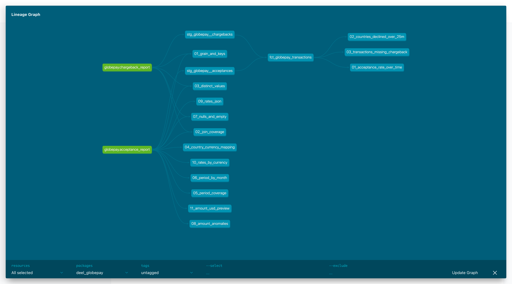

# Part 1 – Ingestion and modeling of the Globepay reports

This document covers Part 1 of the challenge:

1. [Preliminary data exploration](#1-preliminary-data-exploration)
2. [Summary of the model architecture](#2-model-architecture)
3. [Lineage graphs](#3-lineage-graphs)
4. [Tips around macros, data validation and documentation](#4-tips-macros-data-validation-documentation)

**Stack:** dbt Core 1.12 on BigQuery. I used an existing GCP project of mine to avoid setting up a new warehouse from scratch. Since Deel runs on Snowflake, [section 2.4](#24-moving-to-snowflake) maps the BigQuery-specific functions to their Snowflake equivalents.

---

## 1. Preliminary data exploration

### 1.1 Ingestion

The two CSV files came with no schema so they were loaded into the `raw_globepay` dataset with `bq load` and every column as `STRING`. Nothing is parsed or rejected at load time, all type casting happens in dbt staging models: where it is versioned, tested and documented. The two tables are declared as dbt sources in [`_globepay__sources.yml`](../models/staging/globepay/_globepay__sources.yml).

| Raw table | Rows | Columns |
|---|---|---|
| `acceptance_report` | 5,430 | `external_ref`, `status`, `source`, `ref`, `date_time`, `state`, `cvv_provided`, `amount`, `country`, `currency`, `rates` |
| `chargeback_report` | 5,430 | `external_ref`, `status`, `source`, `chargeback` |

### 1.2 Findings

Below is the list of explorative queries used to explore the data in the CSV files. The queries are stored in [`analyses/exploration/`](../analyses/exploration/) and can be run with `dbt show --select <name> --limit 100`.

| # | Check | Finding | Notes |
|---|---|---|---|
| 01 | Grain and keys | `external_ref` is unique and never null in both tables (5,430 / 5,430). `ref` is also unique in the acceptance report. The ID columns are swapped compared with the API spec: the `evt_...` values the spec calls `external_ref` are in `ref` (5,430 / 5,430), and the chargeback `external_ref` matches the acceptance `external_ref` on all rows and `ref` on none. | Grain = one row per payment attempt. `external_ref` → `transaction_id` (primary key, shared by both reports); `ref` → `event_id`. See [1.4](#14-open-question-which-column-is-globepays-external_ref). |
| 02 | Join coverage | All 5,430 transactions are in both reports: no acceptance row without a chargeback row and no orphan chargebacks. | LEFT JOIN from acceptances plus a `relationships` test. |
| 02 | Chargeback vs state | All 223 chargebacks are on `ACCEPTED` transactions (5.9% of accepted). Every `DECLINED` transaction has `chargeback = FALSE`. | For declined attempts, `FALSE` really means "not applicable": chargeback rates must be computed on accepted transactions only. |
| 03 | Distinct values | `status` is always `TRUE` and `source` is always `GLOBALPAY` in both reports. `state`: 3,777 `ACCEPTED`, 1,653 `DECLINED`. `chargeback`: 223 `TRUE`, 5,207 `FALSE`. `cvv_provided`: only 40 `TRUE` (0.7%). | The single-value columns carry no information: kept in staging, not exposed in the mart. `source` is pinned with a `warn` `accepted_values` test; `status` is not tested. |
| 04 | Country ↔ currency | 6 countries, 905 rows each. Each country uses one currency: US→USD, AE→USD, MX→MXN, UK→GBP, FR→EUR, CA→CAD. | The United Kingdom is coded `UK`, not `GB` (documented on the column). AE is charged in USD, not in AED, the UAE currency: it may be USD cards or USD pricing, but it is an anomaly to confirm with Globepay. |
| 05–06 | Period | `date_time` always parses. 1 Jan – 30 Jun 2019, 181 days with no gaps, exactly 30 rows per day at 5 fixed times (00:00, 04:48, 09:36, 14:24, 19:12). | Volume is perfectly flat, so changes in the acceptance rate are not caused by volume. |
| 07 | Nulls / empty strings | No nulls or empty strings in any column of either table. | `not_null` tests on all key columns to catch regressions. |
| 08 | Amounts | All values are parsable and non-zero. One negative amount: -23.78 GBP on an `ACCEPTED` transaction (`SPm_aqm_Rrer_6jxpLvO2`, 1 Jan 2019). Median per currency ≈ 80–89k, max ≈ 180k. **The distribution is the same in every currency** (median 84.8k USD, 88.4k MXN, 88.5k EUR, 79.6k GBP, 88.4k CAD), which is not plausible for real local amounts: 88k MXN is about $3.5k, 88k USD is $88k. | The negative row is kept as reported (it could be a refund or reversal) and flagged by a `warn`-level test. The same-distribution anomaly is why Mexico weighs so little in USD, and it opens a third reading of `amount` (see [1.3](#13-open-question-what-unit-and-currency-is-amount-in)). |
| 09 | `rates` JSON | Always valid JSON with the same 7 keys (AUD, CAD, EUR, GBP, MXN, SGD, USD). `USD = 1` on every row; the rate for the transaction currency is always present and > 0. Some values have more digits than `FLOAT64` can hold exactly, so `PARSE_JSON` needs `wide_number_mode => 'round'`. | Rates are quoted against USD, the settlement currency. |
| 10 | Rate direction and stability | EUR and GBP < 1, CAD ≈ 1.35–1.46, MXN ≈ 25.1, so the rate is units of local currency per 1 USD. Each non-USD currency has one rate per day. EUR and GBP move a lot over the period: EUR goes from 0.92 to 0.67 and GBP from 0.87 to 0.66 per USD (peak to trough), about -25%, with daily moves up to 2–3%. | `amount_usd = amount / rates[currency]`. Rates are taken from each row. The EUR/GBP swing is flagged, not corrected: it changes the USD totals and the UK answer in Q2. |
| 11 | USD preview | Declined amounts in USD per country: FR 32.6M, UK 27.5M, AE 26.3M, US 25.1M, CA 18.4M, MX 0.9M. | Sanity check before building the mart. |

### 1.3 Open question: what unit and currency is `amount` in?

The API specification says the request `amount` is "in minor units" (`1000` = $10.00), but the CSV amounts have two decimals (for example `1020.46`). On top of that, the amounts have the same distribution in every currency (check 08). There are three possible readings, and they give three different answers to Q2:

| Reading of `amount` | Highest declined total per country | Countries over $25M |
|---|---|---|
| **Major units, in the transaction currency, converted with `rates` (chosen)** | FR $32.6M | **FR, UK, AE, US** |
| Major units, already in USD (no conversion) | AE $26.3M | AE, CA, US |
| Minor units | FR $0.33M ($0.26M if already in USD) | none |

**Assumption: `amount` is in major units, in the currency of the `currency` column.**

Evidence:
- **Not minor units.** Amounts in minor units are always integers, while 5,382 of the 5,430 values have decimals. This comes from the data and rules out the third reading.
- **Transaction currency, not USD.** In the API response, `amount` ("the amount that has been charged from the card") comes with its own `currency` field, and settlement in USD is described as a separate step ("Funds are settled to you in USD"). The `currency` column changes row by row (USD, MXN, GBP, EUR, CAD), so it labels the amount. This is the main argument, but it rests on the spec, not on the data: the data alone cannot tell the first two readings apart.

Supporting hints, not proof:
- the $25M threshold in the analyst's question is reachable only in major units (in minor units no country gets above $0.33M). This infers the meaning of the data from the question, so it only supports a conclusion reached on other grounds;
- every row carries the `rates` used by Globepay, which fits amounts that need converting. But `rates` also holds AUD and SGD, which no transaction uses, so it may be informational only and does not prove that `amount` is in local currency.

Risks to confirm with Globepay:
- the same distribution in every currency suggests the amounts may have been generated without regard to the currency; if they are really USD, the Q2 answer becomes AE, CA, US;
- the average payment is high for card funding: median about $69k and mean about $79k per attempt in USD.

If the reading is wrong, the fix is in one place, `stg_globepay__acceptances` (drop the conversion, or divide by 100).

### 1.4 Open question: which column is Globepay's `external_ref`?

In the API specification the response example has `external_ref = evt_1ESgcCOV7fY1ChY1MkZizZt`. In the CSV that value is in the `ref` column of the first row (same timestamp as the example, `2019-01-01T00:00:00.000Z`), while `external_ref` holds `nCyEIIGaP5QQ2Wqb-_Rt8`. All 5,430 `ref` values have the `evt_` prefix and no `external_ref` value does, so the two columns are swapped compared with the spec. The spec is not reliable on this field anyway: it describes `external_ref` as "The card expiry year".

**Decision: the primary key and join key is the CSV `external_ref` column.**

The chargeback report has only `external_ref`, and it matches the acceptance `external_ref` on all 5,430 rows and the acceptance `ref` on none (check 01). The key is chosen from the data, not from the spec:
- CSV `external_ref` → `transaction_id`: the ID shared by the two reports;
- CSV `ref` → `event_id`: the `evt_...` ID that the spec calls `external_ref`.

The join and the answers to the three questions are not affected. Before these IDs are used to reconcile with Globepay or with Deel's own systems, Globepay should confirm which one it exposes as `external_ref`.

---

## 2. Model architecture

### 2.1 Layers

The project follows the [dbt project structure guide](https://docs.getdbt.com/best-practices/how-we-structure/1-guide-overview):
**sources → staging → marts**.

| Layer | Model | Materialization | Dataset | Grain | Role |
|---|---|---|---|---|---|
| Source | `globepay.acceptance_report` | raw table | `raw_globepay` | 1 row per transaction | Raw CSV, all `STRING` |
| Source | `globepay.chargeback_report` | raw table | `raw_globepay` | 1 row per transaction | Raw CSV, all `STRING` |
| Staging | `stg_globepay__acceptances` | view | `analytics_staging` | 1 row per transaction | Rename, cast, derive `is_accepted`, extract the FX rate, compute `amount_usd` |
| Staging | `stg_globepay__chargebacks` | view | `analytics_staging` | 1 row per transaction | Rename, cast `chargeback` to boolean |
| Mart | `fct_globepay_transactions` | table | `analytics_finance` | 1 row per transaction | Acceptances LEFT JOIN chargebacks: the single model the analyst queries |

No intermediate layer because the pipeline contains only one join and no reusable business logic it would add a model without adding clarity. If one is needed later (e.g. to combine Globepay with another payment processor), it would go in `models/intermediate/`, materialized as `ephemeral`.

### 2.2 Design choices

- Staging = one model per source table, 1:1 with the source grain. Only renames, casts and
  row-level derived columns. No joins, no filters, no aggregations.
- Consistent naming. `*_id` for keys, `*_at` for timestamps, `is_*` / `has_*` for booleans,
  `*_code` for ISO-style codes, `amount_*` with the currency in the name (`amount_local`, `amount_usd`).
- USD conversion in staging. It is a row-level calculation that only needs columns from the same row,
  so every downstream model gets the same `amount_usd`.
- LEFT JOIN plus an explicit "missing" flag in the mart. `has_chargeback_data` tells "no row in the chargeback report"
  apart from "row with `chargeback = FALSE`". `is_chargeback` stays `NULL` when the data is missing,
  instead of defaulting to `FALSE`.
- Mart as a table in a dedicated finance dataset: fast and cheap for the analyst to query, and rebuilt in seconds at this volume.
- Single environment. For the scope of the challenge there is only one dbt target (`prod`, dataset `analytics`).
  dbt's default schema naming appends the custom schema to the target dataset (`<target dataset>_<custom schema>`),
  so the models land in `analytics_staging` and `analytics_finance`. Separate dev and prod environments are the next step (see [4.1](#41-macros)).

### 2.3 Mart columns

| Column | Type | Description |
|---|---|---|
| `transaction_id` | STRING | Primary key (`external_ref`) |
| `event_id` | STRING | Globepay event ID (`ref`) |
| `transaction_at` / `transaction_date` | TIMESTAMP / DATE | When the attempt happened (UTC) |
| `country_code`, `currency_code` | STRING | Card country (`UK` for the United Kingdom) and transaction currency |
| `transaction_state`, `is_accepted` | STRING / BOOL | Outcome of the attempt |
| `is_cvv_provided` | BOOL | CVV sent with the request |
| `amount_local`, `fx_rate_to_usd`, `amount_usd` | NUMERIC / FLOAT64 / NUMERIC | Amount in local currency, Globepay rate, amount in USD |
| `has_chargeback_data` | BOOL | `FALSE` = no row in the chargeback report |
| `is_chargeback` | BOOL | `TRUE` / `FALSE`; `NULL` = unknown |

### 2.4 Moving to Snowflake

The models only use a few BigQuery-specific functions, their Snowflake equivalents are:

| BigQuery | Snowflake |
|---|---|
| `PARSE_JSON(rates, wide_number_mode => 'round')[currency]` + `LAX_FLOAT64(...)` | `GET(TRY_PARSE_JSON(rates), currency)::FLOAT` |
| `CAST(x AS BOOL)` | `TO_BOOLEAN(x)` |
| `COUNTIF(cond)` | `COUNT_IF(cond)` |
| `DATE_TRUNC(date, MONTH)` | `DATE_TRUNC('MONTH', date)` |

---

## 3. Lineage graphs

### 3.1 Models

Lineage graph from dbt docs, selection `+fct_globepay_transactions+` (sources in green):



### 3.2 Exploration analyses

The exploration queries read the raw sources directly, so they do not depend on any modeling decision.
Full project graph from dbt docs (no selection):



The screenshots above come from the dbt docs site. To open the interactive DAG:

```bash
export DBT_PROFILES_DIR=.
.venv/bin/dbt docs generate
.venv/bin/dbt docs serve 
```

### 3.3 Column-level lineage of the mart

| Mart column | Staging column | Raw column | Transformation |
|---|---|---|---|
| `transaction_id` | `stg_globepay__acceptances.transaction_id` | `acceptance_report.external_ref` | rename |
| `transaction_at` | `transaction_at` | `date_time` | `CAST AS TIMESTAMP` |
| `transaction_date` | `transaction_at` | `date_time` | `DATE()` |
| `is_accepted` | `is_accepted` | `state` | `state = 'ACCEPTED'` |
| `amount_local` | `amount_local` | `amount` | `CAST AS NUMERIC` |
| `fx_rate_to_usd` | `fx_rate_to_usd` | `rates`, `currency` | `rates[currency]` |
| `amount_usd` | `amount_usd` | `amount`, `rates`, `currency` | `amount / rates[currency]` |
| `has_chargeback_data` | `stg_globepay__chargebacks.transaction_id` | `chargeback_report.external_ref` | `IS NOT NULL` after the LEFT JOIN |
| `is_chargeback` | `is_chargeback` | `chargeback` | `CAST AS BOOL` |

---

## 4. Tips: macros, data validation, documentation

### 4.1 Macros

**Used in this project**

- `dbt_utils` (`expression_is_true`, `equal_rowcount`) for generic tests instead of hand-written SQL tests.

**Recommended next**

- Separate dev and prod, and override `generate_schema_name`. Add a `dev` target in `profiles.yml` with a personal dataset per developer (`dbt_<user>`), then override `generate_schema_name` with dbt's built-in `generate_schema_name_for_env`: in dev every model goes to the developer's own dataset, so work in progress never touches what the analyst queries, while prod uses clean names (`finance` instead of `analytics_finance`), which is what analysts and BI tools should point to:

  ```sql
  
      {{ generate_schema_name_for_env(custom_schema_name, node) }}
  
  ```

- A `to_usd()` macro for the conversion so that any future Globepay report converts amounts the same way:

  ```sql
  
      CAST(
          {{ amount_column }}
          / LAX_FLOAT64(PARSE_JSON({{ rates_column }}, wide_number_mode => 'round')[{{ currency_column }}])
          AS NUMERIC
      )
  
  ```

### 4.2 Data validation

The project has 30 data tests. Two rules decide where each test goes and how strict it is.

**Each property is tested once, in the layer where it is created.** A renamed column is not tested again downstream: if `external_ref` is unique in the source, `transaction_id` is unique in staging too.

| Layer | What is tested | Tests |
|---|---|---|
| Sources | Raw keys and raw values | `unique` / `not_null` on `external_ref` in both reports; `relationships` in both directions (chargebacks → acceptances, and acceptances → chargebacks for Q3); `not_null` + `accepted_values` on `state` and `chargeback` |
| Staging | Casts and derived columns | `not_null` on the cast columns (`transaction_at`, `is_cvv_provided`, `is_chargeback`, amounts); `unique` / `not_null` on `event_id`; `accepted_values` on country, currency and source system; FX rate `> 0`; `amount_local >= 0` |
| Mart | What the join creates | `unique` / `not_null` on `transaction_id` and `equal_rowcount` against staging (the join never adds or drops rows); `not_null` on `is_chargeback` only `where has_chargeback_data` |

**`error` when a failure makes the model wrong, `warn` when it is a business anomaly the model can carry.**

| Severity | When | Tests |
|---|---|---|
| `error` (stops the build) | Grain, keys, and values the logic depends on | keys `unique` / `not_null`, chargebacks → acceptances, `state` and `chargeback` values (`is_accepted` and the BOOL cast depend on them), cast columns `not_null`, FX rate `> 0`, mart grain and join |
| `warn` (reported, build goes on) | Business anomalies | a new country, currency or source system; a negative amount (the known -23.78 GBP row); a payment attempt with no chargeback row (Q3) |

A new country is a business event, not a broken pipeline: it is reported and the model handles it (the FX rate comes from the same row).

**Recommended next**

- Source freshness: add a load timestamp (`_loaded_at`) when ingesting and a `freshness` block on the sources.
- Unit tests on `stg_globepay__acceptances` with a few fixed rows (USD, EUR, a negative amount) to lock the direction of the FX conversion.
- CI: `dbt build --select state:modified+` on every pull request so a change is never merged with failing tests.

### 4.3 Documentation

**Used in this project**

- Descriptions on every model and column in YAML, and on the sources and their key columns, including the edge cases (`UK` instead of `GB`, the negative amount, `is_chargeback` NULL = unknown) and the major-units assumption on `amount_local`.
- `persist_docs` (relation and columns) in `dbt_project.yml`: the descriptions are also written to BigQuery, so the analyst sees them in the warehouse UI without opening dbt docs.
- A guide for the analyst ([`analyses/questions/insights.md`](../analyses/questions/insights.md)) with the columns to use, caveats and example queries.

**Recommended next**

- Doc blocks (``) for columns repeated in several YAML files
  (`transaction_id`, `country_code`, `amount_usd`), so each description is written once.
- Exposures for the dashboards or notebooks that use `fct_globepay_transactions` so they appear in the lineage and their owners know when the model changes.
